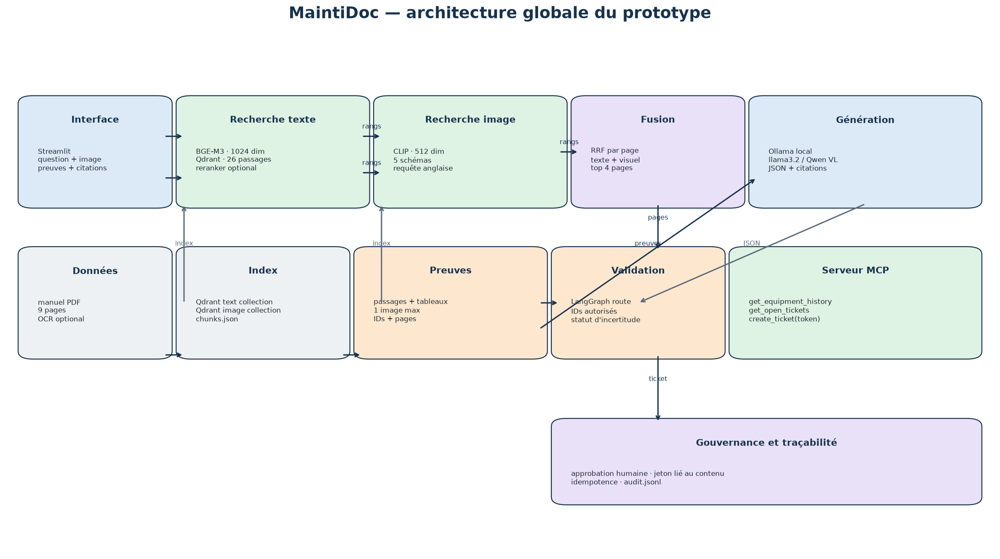
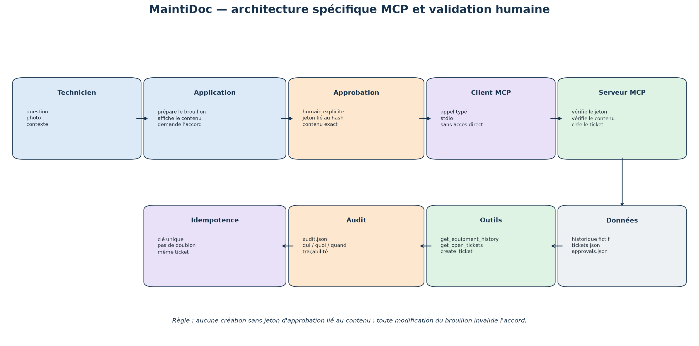

# MaintiDoc — assistant documentaire multimodal et agentique

**Projet intégrateur SAN-LAB 2000** — démonstration jusqu'à l'étape **MCP**.

MaintiDoc répond à des questions de maintenance à partir d'un manuel PDF fictif,
retrouve les passages et les schémas pertinents, produit une réponse **JSON avec
citations**, et expose l'historique et la création de tickets via un **serveur
MCP** avec **validation humaine**.

> Le projet ne pilote aucun équipement. Il ne garantit pas un diagnostic.
> Il ne crée jamais de ticket sans approbation explicite.

---

## 1. Ce qui est livré

| Brique | État |
|---|---|
| Extraction texte / tableaux / images | fait |
| Nettoyage des tableaux avec `get_textbox` | fait |
| OCR optionnel des figures | fait (`rapidocr`) |
| Index texte **BGE-M3** | fait |
| Index image **CLIP ViT-B/32** | fait |
| Stockage **Qdrant local persistant** | fait |
| Upload d’une photo + analyse VLM | fait (`qwen2.5vl:3b`) |
| Reranker multilingue optionnel | fait |
| Fusion **RRF** texte + visuel | fait |
| Orchestration **LangGraph** | fait |
| Dossier de preuves borné | fait |
| Génération locale **Ollama** + JSON | fait |
| Validation structurelle des citations | fait |
| Fallback extractif sans modèle | fait |
| Serveur **MCP** : 3 outils | fait |
| Jeton d'approbation + idempotence + audit | fait |
| Interface **Streamlit** (4 onglets) | fait |
| Notebooks pédagogiques | 6 notebooks exécutés |
| Schémas d'architecture | globaux et MCP |
| Tests | 9 tests pytest |

**Limites assumées :** Qdrant est utilisé en **mode local fichier** (pas de serveur
Qdrant), le reranker est optionnel, l'OCR est optionnel, l'authentification/RBAC
et le fine-tuning ne sont pas implémentés.

---

## 2. Démarrage rapide

### 2.1. Environnement

```powershell
cd maintidoc
uv sync
```

Le projet utilise **Python 3.12** et `uv`.

### 2.2. Modèle local

Le modèle par défaut est `llama3.2:latest` :

```powershell
ollama pull llama3.2:latest
ollama list
```

Pour utiliser Qwen :

```powershell
ollama pull qwen2.5vl:7b
```

puis modifier `OLLAMA_MODEL` dans `src/maintidoc/config.py` ou le champ
« Modèle Ollama » dans l'application.

### 2.3. Construire les artefacts

```powershell
uv run python -m maintidoc.ingest
```

Cela produit :

```text
data/processed/
├── document.json
├── texts.json
├── tables.json
├── chunks.json
├── inventory.csv
├── images/
└── index/
```

Construire ensuite les collections Qdrant locales :

```powershell
uv run python -m maintidoc.vector_store
```

OCR optionnel des figures :

```powershell
uv run python -m maintidoc.ocr
```

### 2.4. Lancer les notebooks

Ouvrir Jupyter avec le kernel **MaintiDoc (3.12)** :

```powershell
uv run jupyter lab
```

Ordre recommandé :

1. `notebooks/01_corpus_inventory.ipynb` — inventaire ;
2. `notebooks/02_extraction_chunks.ipynb` — tableaux et passages ;
3. `notebooks/03_rag_multimodal.ipynb` — BGE-M3, CLIP, RRF ;
4. `notebooks/04_generation_citations.ipynb` — Ollama et citations ;
5. `notebooks/05_mcp_demo.ipynb` — MCP, approbation et idempotence ;
6. `notebooks/06_agentic_rag.ipynb` — Qdrant, reranker, OCR, LangGraph.

Chaque cellule Markdown explique **ce que fait la cellule suivante** et chaque
cellule de code est suivie d'une section **« Lecture du résultat »**.

### 2.5. Application Streamlit

```powershell
uv run streamlit run app.py
```

L'application propose quatre onglets :

- recherche + réponse sourcée ;
- **agent LangGraph** (retrieve → generate → validate → clarification) ;
- tickets MCP + approbation ;
- corpus et schémas.

L'interface est en **anglais**. Les notebooks et leurs explications restent en
**français** ; le modèle répond en anglais dans l'application et en français dans
les notebooks.

### 2.6. Démonstration MCP seule

```powershell
uv run python mcp_client.py --reset
```

Le client liste les outils, consulte l'historique, prépare un brouillon, simule
l'approbation humaine, crée le ticket, vérifie l'idempotence et le refus sans
jeton.

### 2.7. Docker et base de données

```powershell
docker compose up -d --build
```

Services :

| Service | Adresse |
|---|---|
| Application | http://localhost:8501 |
| Adminer (PostgreSQL) | http://localhost:8080 |
| Qdrant | http://localhost:6333/dashboard |
| MinIO (API S3) | http://localhost:9000 |
| MLflow (profil `mlops`) | http://localhost:5000 |

PostgreSQL :

```text
Host     : localhost
Port     : 5432
Database : maintidoc
User     : maintidoc
Password : maintidoc_dev
```

Guide complet : [docs/docker.md](docs/docker.md).

> Qdrant est utilisé par l’application. PostgreSQL et MinIO sont provisionnés
> pour la cible ; le serveur MCP utilise encore ses fichiers JSON mock.

---

## 3. Architecture

### 3.1. Vue globale



```text
PDF → PyMuPDF → textes / tableaux / images
    → BGE-M3 (texte) + CLIP (image)
    → fusion RRF par page
    → dossier de preuves
    → Ollama (JSON)
    → validation des citations
    → ticket MCP après approbation humaine
```

### 3.2. Vue MCP



Le serveur MCP expose :

```text
get_equipment_history(equipment_id)
get_open_tickets(equipment_id)
create_ticket(equipment_id, title, description, approval_token, idempotency_key)
```

Le jeton est **lié au hash du contenu** : modifier le titre ou la description
invalide l'approbation. Une clé d'idempotence évite les doublons.

---

## 4. Structure du dépôt

```text
maintidoc/
├── app.py                     application Streamlit
├── mcp_server.py              point d'entrée MCP (stdio)
├── mcp_client.py              client de démonstration
├── pyproject.toml
├── uv.lock
├── data/
│   ├── raw/                   manuel PDF
│   ├── processed/             textes, tableaux, images, index
│   └── mock/                  historique, tickets, approbations, audit
├── docs/
│   ├── architecture.md
│   ├── architecture_complete.md
│   ├── llmography_evaluation.md
│   ├── roadmap_localisation.md
│   ├── comparatif_deepseek_claude.md
│   ├── architecture_globale.png
│   ├── architecture_mcp.png
│   ├── ingestion.md
│   ├── retrieval.md
│   ├── generation.md
│   ├── agent.md
│   ├── mcp.md
│   ├── evaluation.md
│   ├── corpus_notes.md
│   ├── decisions.md
│   ├── demo.md
│   ├── utilisation.md
│   ├── docker.md
│   └── limites.md
├── eval/
│   ├── questions.jsonl
│   ├── results.csv
│   └── run_eval.py
├── notebooks/                 6 notebooks exécutés
├── prompts/
│   └── answer_v1.txt
├── scripts/
│   └── make_architecture.py
├── src/maintidoc/
│   ├── config.py
│   ├── ingest.py
│   ├── ocr.py
│   ├── vision.py
│   ├── retrieval.py
│   ├── rerank.py
│   ├── vector_store.py
│   ├── graph.py
│   ├── generation.py
│   ├── mcp_store.py
│   ├── mcp_server.py
│   └── mcp_calls.py
└── tests/
```

### Documentation détaillée

| Document | Contenu |
|---|---|
| [docs/architecture_complete.md](docs/architecture_complete.md) | architecture complète et synthèse du projet |
| [docs/llmography_evaluation.md](docs/llmography_evaluation.md) | évaluation du processus Humain–IA (LLMography) |
| [docs/roadmap_localisation.md](docs/roadmap_localisation.md) | localisation des cartes de la feuille de route |
| [docs/comparatif_deepseek_claude.md](docs/comparatif_deepseek_claude.md) | tokens et coûts DeepSeek vs Claude |
| [docs/ingestion.md](docs/ingestion.md) | extraction PDF, tables, images, chunks, OCR |
| [docs/retrieval.md](docs/retrieval.md) | BGE-M3, CLIP, Qdrant, RRF, reranker, preuves |
| [docs/generation.md](docs/generation.md) | prompt, Ollama, JSON, citations, fallback |
| [docs/agent.md](docs/agent.md) | LangGraph, état, nœuds, clarification |
| [docs/mcp.md](docs/mcp.md) | outils MCP, approbation, idempotence, audit |
| [docs/evaluation.md](docs/evaluation.md) | questions, métriques, résultats |
| [docs/utilisation.md](docs/utilisation.md) | guide pas à pas de l’application |
| [docs/docker.md](docs/docker.md) | Docker, PostgreSQL, Adminer, Qdrant, MinIO |

---

## 5. Résultats de la recherche

Évaluation sur **14 questions** de référence (`eval/questions.jsonl`) :

| Métrique | Sans reranker | Avec reranker |
|---|---:|---:|
| Recall@5 texte | **0,857** | 0,786 |
| Recall@5 après RRF | **0,929** | 0,857 |
| Recall@3 figures | **0,714** | 0,714 |
| MRR page | **0,667** | 0,598 |

Le reranker est donc **inclus mais désactivé par défaut** : sur ce corpus de 14
questions, il dégrade légèrement le rappel. C’est un résultat à documenter, pas à
masquer. Il est activable dans l’application ou via `Pipeline.search(rerank=True)`.

Les résultats sont dans `eval/results.csv`. Le corpus est petit : ces scores ne
valent pas pour un corpus de production.

---

## 6. Format de réponse

```json
{
  "status": "answered",
  "answer": "Le voyant orange AL-01 indique une dégradation du chemin FC...",
  "citations": [{"id": "P05-TAB01", "page": 5}],
  "uncertainties": []
}
```

Statuts : `answered`, `needs_clarification`, `insufficient_evidence`.

Une citation est **structurellement** valide si l'ID et la page existent dans les
preuves. La validation **sémantique** — le passage soutient-il l'affirmation ? —
reste manuelle.

---

## 7. Commandes utiles

```powershell
# Ingestion
uv run python -m maintidoc.ingest

# Tests
uv run python -m pytest -q

# Évaluation retrieval
uv run python eval/run_eval.py

# MCP
uv run python mcp_client.py --reset

# Streamlit
uv run streamlit run app.py
```

---

## 8. Limites et prochaines étapes

Voir [docs/limites.md](docs/limites.md).

Prochaines étapes du CDC :

1. Qdrant en **serveur** (le prototype utilise le mode local persistant) ;
2. reranker **activé et calibré** sur un corpus plus large ;
3. FastAPI + authentification + RBAC ;
4. prompts YAML versionnés ;
5. évaluation de 150 scénarios ;
6. fine-tuning du reranker ;
7. Docker Compose + MLflow.

---

## 9. Avertissement

Le manuel, les alarmes, les tickets et les incidents sont **fictifs**. Les
réponses ne doivent pas être utilisées sur une baie SAN réelle. Toute action
sensible reste soumise à validation humaine.
