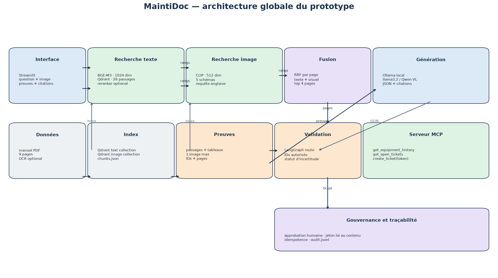
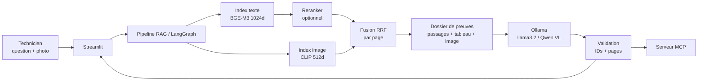
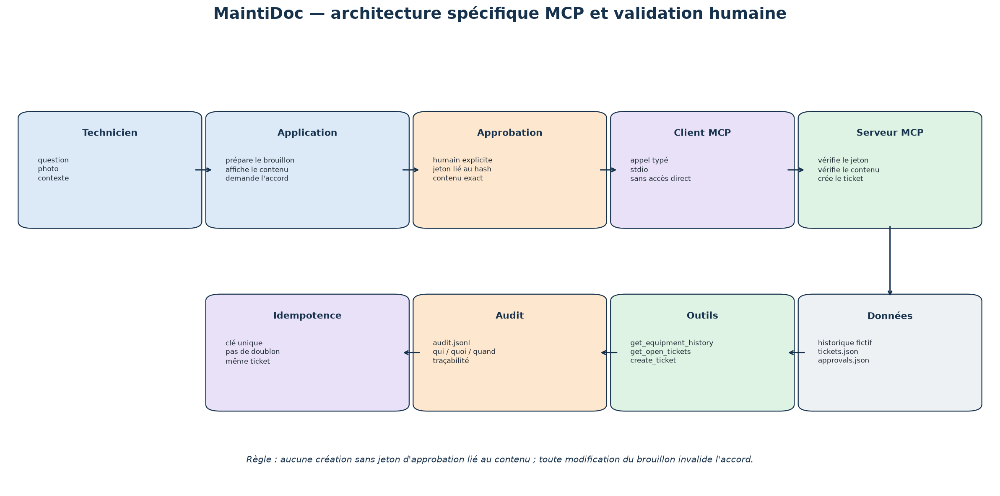
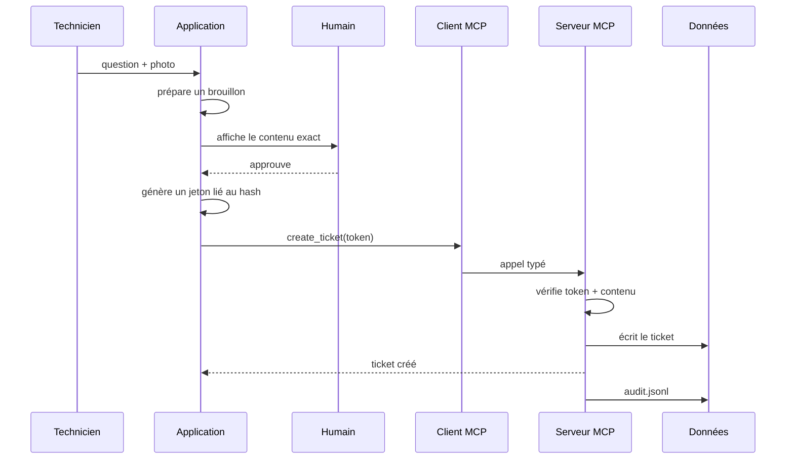

# Architecture MaintiDoc

Deux vues sont nécessaires :

1. **architecture globale** : comment une question devient une réponse sourcée ;
2. **architecture MCP** : comment une action sensible est préparée, approuvée,
   puis exécutée.

---

## 1. Architecture globale





### Composants

| Composant | Rôle | Fichier |
|---|---|---|
| `ingest.py` | PDF → textes, tableaux, images, chunks | `src/maintidoc/ingest.py` |
| `ocr.py` | OCR optionnel des figures | `src/maintidoc/ocr.py` |
| `retrieval.py` | BGE-M3, CLIP, RRF, preuves | `src/maintidoc/retrieval.py` |
| `rerank.py` | reranker cross-encoder multilingue | `src/maintidoc/rerank.py` |
| `vector_store.py` | Qdrant local persistant | `src/maintidoc/vector_store.py` |
| `graph.py` | workflow LangGraph | `src/maintidoc/graph.py` |
| `generation.py` | prompt, Ollama, JSON, citations | `src/maintidoc/generation.py` |
| `app.py` | interface de démonstration | `app.py` |
| `mcp_server.py` | outils MCP | `src/maintidoc/mcp_server.py` |
| `mcp_store.py` | données mock, approbation, audit | `src/maintidoc/mcp_store.py` |

### Flux

1. Le PDF est extrait **hors ligne**.
2. Les passages et les figures sont indexés.
3. Une question déclenche deux recherches.
4. Les rangs sont fusionnés par page (RRF).
5. Un dossier de preuves borné est construit.
6. Le modèle produit un JSON.
7. Les citations sont vérifiées.
8. L'interface affiche la réponse, les preuves et les incertitudes.

---

## 2. Architecture MCP





### Règles

- Le **client MCP** ne connaît pas la base : il appelle des outils typés.
- Le **serveur** vérifie le jeton et le contenu.
- Le jeton est lié au hash `(equipment_id, title, description)`.
- Une modification du brouillon invalide l'accord.
- Une clé d'idempotence empêche les doublons.
- Chaque appel écrit dans `audit.jsonl`.

### Outils

| Outil | Type | Effet |
|---|---|---|
| `get_equipment_history` | lecture | retourne l'historique |
| `get_open_tickets` | lecture | retourne les tickets ouverts |
| `create_ticket` | écriture | crée après approbation |

### Données mock

```text
data/mock/
├── maintenance_history.json
├── tickets.json
├── ticket_drafts.json
├── approvals.json
└── audit.jsonl
```

---

## 3. Choix et limites

- Qdrant est utilisé en **mode local persistant** (`data/processed/index/qdrant`),
  pas en serveur. Les collections `maintidoc_text` et `maintidoc_images` sont
  séparées.
- Le reranker multilingue est **inclus mais désactivé par défaut** : il dégrade
  le rappel sur les 14 questions actuelles.
- L'OCR est **optionnel** (`rapidocr`) pour les PDF scannés et les libellés de
  figures.
- `graph.py` implémente le workflow LangGraph : retrieve → generate → validate →
  answer/clarify.
- Le modèle est **local** via Ollama ; `llama3.2:latest` est le défaut,
  `qwen2.5vl:7b` est prévu pour le multimodal complet.
- La fusion est **au niveau des pages**, pas des éléments.
- La validation des citations est **structurelle**, pas sémantique.
- L'authentification et le RBAC ne sont pas implémentés.
