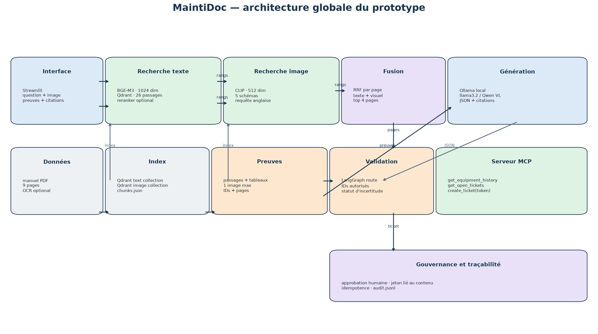
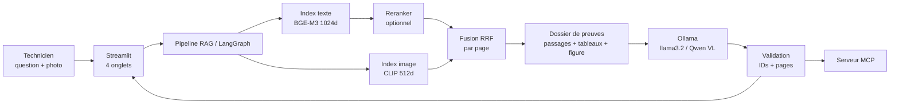
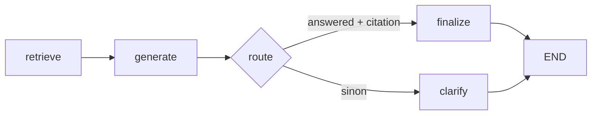
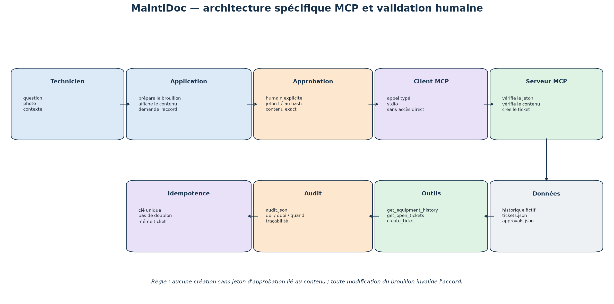
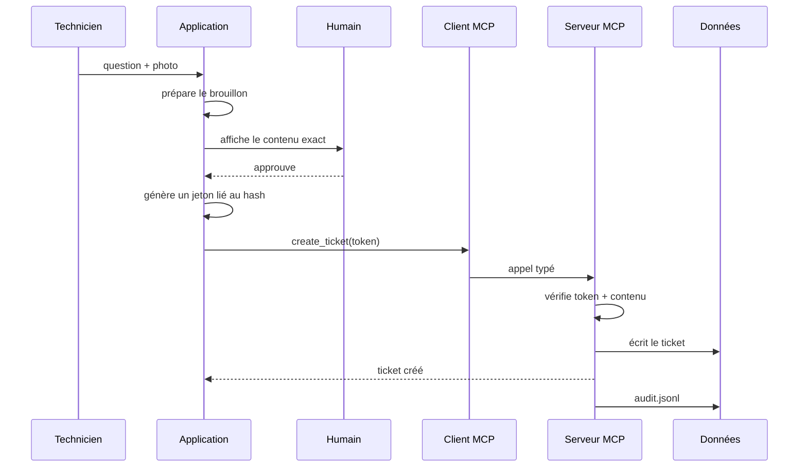
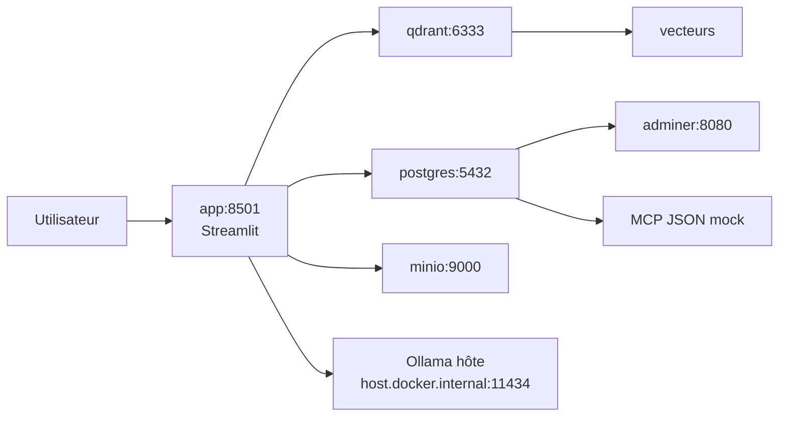

# MaintiDoc — Architecture complète et synthèse du projet

**Projet intégrateur SAN-LAB 2000** — assistant documentaire multimodal et
agentique pour la maintenance.

Cette page est la vue consolidée du projet : objectifs, architecture, flux de
données, MCP, Docker, évaluation, limites et état d’avancement.

---

## 1. Fiche d’identité

| Élément | Valeur |
|---|---|
| Projet | MaintiDoc |
| Équipement | SAN-LAB 2000 (fictif) |
| Corpus | manuel `SAN-MAN-001`, 9 pages, 9 tableaux, 5 schémas |
| Utilisateurs | techniciens et responsables de maintenance |
| Langue de l’interface | anglais |
| Langue des notebooks | français |
| Génération locale | Ollama `llama3.2:latest` par défaut |
| VLM optionnel | `qwen2.5vl:3b` installé, non utilisé par défaut |
| Recherche texte | BGE-M3, 1024 dimensions |
| Recherche image | CLIP ViT-B/32, 512 dimensions |
| Base vectorielle | Qdrant local ou serveur |
| Base relationnelle | PostgreSQL 16 |
| Stockage objet | MinIO |
| Orchestration | LangGraph |
| Outils externes | MCP, 3 outils |
| Interface | Streamlit, 4 onglets |
| Déploiement | Docker Compose |

---

## 2. Le problème

Un technicien doit interpréter un voyant, un code d’alarme, un schéma de câblage
ou une procédure. L’information est dispersée entre :

- un manuel PDF ;
- des tableaux ;
- des schémas ;
- l’historique des interventions ;
- les tickets.

Le problème n’est pas l’absence de documentation : c’est l’accès **rapide, fiable
et traçable** à la bonne information.

MaintiDoc doit :

1. retrouver les passages et figures pertinents ;
2. répondre uniquement à partir de preuves ;
3. citer la page et l’élément utilisés ;
4. s’abstenir ou demander une clarification si les preuves manquent ;
5. préparer un ticket, sans le créer sans validation humaine.

Il ne doit pas :

- piloter une baie SAN ;
- garantir un diagnostic ;
- remplacer un technicien ;
- obéir aux instructions contenues dans un document.

---

## 3. Vue globale





### Les quatre couches

| Couche | Rôle | Modules |
|---|---|---|
| **Données** | PDF → textes, tableaux, images, chunks | `ingest.py`, `ocr.py` |
| **Recherche** | BGE-M3, CLIP, Qdrant, RRF, reranker | `retrieval.py`, `vector_store.py`, `rerank.py` |
| **Décision** | réponse, clarification, orchestration | `generation.py`, `graph.py` |
| **Action** | historique, ticket, approbation, audit | `mcp_server.py`, `mcp_store.py` |

---

## 4. Chaîne hors ligne : ingestion

```text
PDF
 │
 ├─ PyMuPDF → texte page par page
 ├─ PyMuPDF → tableaux
 ├─ PyMuPDF → images / schémas
 └─ RapidOCR → texte des figures (optionnel)
 │
 ▼
Nettoyage + métadonnées + découpage
 │
 ├─► BGE-M3 → embeddings texte
 └─► CLIP   → embeddings image
 │
 ▼
Qdrant + artefacts JSON
```

### 4.1. Le point critique des tableaux

`table.extract()` perd les espaces :

```text
Valeurpedagogique
SAN -LAB 2000
AetB
```

La correction utilise le rectangle de chaque cellule :

```python
page.get_textbox(pymupdf.Rect(cell))
```

Résultat :

```text
Valeur pedagogique
SAN-LAB 2000
A et B
```

### 4.2. Artefacts produits

```text
data/processed/
├── document.json       textes + tableaux + images
├── texts.json          texte par page
├── tables.json         tableaux nettoyés
├── chunks.json         26 passages indexables
├── inventory.csv       inventaire des 9 pages
├── ocr_figures.json    OCR des figures
├── images/
│   ├── cover_page01.png
│   └── fig01_page02.png … fig05_page06.png
└── index/
    ├── text_embeddings.npy
    ├── image_embeddings.npy
    └── qdrant/
```

### 4.3. Identifiants et provenance

Chaque élément possède :

- `document_id` ;
- `revision` ;
- `page` ;
- `element_id` ;
- `type` : `text`, `table`, `image` ;
- `sha256`.

Exemples :

```text
P05-TEXT      page 5, texte
P05-TAB01     page 5, tableau
P05-IMG01     page 5, image
FIG-04        figure d’alarme
```

Ces identifiants sont la base des citations.

---

## 5. Index et stockage

### 5.1. Deux index

| Index | Modèle | Dimension | Collection Qdrant |
|---|---|---:|---|
| Texte | BGE-M3 | 1024 | `maintidoc_text` |
| Image | CLIP ViT-B/32 | 512 | `maintidoc_images` |

Pourquoi séparer :

- les modèles et les scores sont différents ;
- les métadonnées sont différentes ;
- on peut mettre à jour l’un sans reconstruire l’autre.

### 5.2. Qdrant

Deux modes :

```text
local fichier : data/processed/index/qdrant
serveur       : QDRANT_URL=http://qdrant:6333
```

Le mode Docker utilise le serveur. Le mode notebook utilise le mode local.

### 5.3. PostgreSQL

Tables provisionnées :

```text
documents
elements
maintenance_history
tickets
ticket_drafts
approvals
audit_log
```

État :

- schéma créé ;
- 4 interventions fictives insérées ;
- **MCP utilise encore les fichiers JSON mock** ;
- la migration MCP → PostgreSQL reste à faire.

### 5.4. MinIO

- API S3 : `http://localhost:9000` ;
- bucket `maintidoc` créé ;
- non branché à l’application pour l’instant ;
- prévu pour les PDF et images originales.

---

## 6. Recherche en ligne

```text
Question + image
 │
 ├─► BGE-M3 ──► top passages
 └─► CLIP   ──► top figures
 │
 ▼
Reranker optionnel
 │
 ▼
RRF par page
 │
 ▼
Dossier de preuves
```

### 6.1. Similarité

$$
\operatorname{sim}(q,d)=\frac{q\cdot d}{\|q\|\|d\|}
$$

Un score élevé signifie « proche », pas « pertinent » ni « vrai ».

### 6.2. RRF

$$
\operatorname{RRF}(d)=\sum_{r\in R(d)}\frac{1}{k+\operatorname{rank}_r(d)}
$$

On fusionne les **rangs** parce que les scores BGE-M3 et CLIP ne sont pas
comparables.

### 6.3. Reranker

Cross-encoder :

```text
cross-encoder/mmarco-mMiniLMv2-L12-H384-v1
```

Il réordonne les passages, mais sur les 14 questions actuelles il dégrade le
rappel. Il est donc **inclus mais désactivé par défaut**.

### 6.4. Preuves

Le dossier contient :

- quelques passages ;
- un tableau ;
- au plus une figure ;
- un budget d’environ 8 500 caractères.

Chaque preuve garde `id`, `page`, `type`, `content`.

---

## 7. Génération et citations

```text
preuves + question
 │
 ▼
prompt avec IDs autorisés
 │
 ▼
Ollama JSON
 │
 ▼
parse → sanitize → validate
 │
 ├─ answered
 ├─ needs_clarification
 └─ insufficient_evidence
```

### 7.1. Sortie

```json
{
  "status": "answered",
  "answer": "Le voyant orange AL-01 indique un chemin FC dégradé...",
  "citations": [{"id": "P05-TAB01", "page": 5}],
  "uncertainties": []
}
```

### 7.2. Validation

- l’ID et la page existent-ils dans les preuves ?
- une réponse `answered` a-t-elle une citation ?
- les citations inconnues sont-elles retirées ?

C’est une validation **structurelle**. Le soutien sémantique reste manuel.

### 7.3. Fallback

Si Ollama est indisponible ou renvoie un JSON invalide :

- réponse extractive ;
- citation d’une preuve ;
- mention explicite du mode `fallback`.

Ce n’est pas une réponse de production, mais la démonstration reste possible.

---

## 8. Agent LangGraph



### État

```python
{
    "question": str,
    "visual_query": str,
    "retrieval": dict,
    "answer": dict
}
```

### Décision

```python
if answer.status == "answered" and answer.citations:
    finalize
else:
    clarify
```

### Ce que LangGraph apporte

- état intermédiaire ;
- routage conditionnel ;
- clarification ;
- base pour ajouter des outils MCP ;
- base pour des reprises et interruptions humaines.

### Ce qu’il n’apporte pas encore

- pas de boucle de reformulation ;
- pas d’appel MCP dans le graphe ;
- pas de persistance d’état ;
- pas d’`interrupt()` pour l’approbation.

---

## 9. MCP et validation humaine





### Outils

| Outil | Type | Effet |
|---|---|---|
| `get_equipment_history` | lecture | historique des interventions |
| `get_open_tickets` | lecture | tickets ouverts |
| `create_ticket` | écriture | ticket après approbation |

### Règles

- le jeton est lié au hash `(equipment_id, title, description)` ;
- modifier le contenu invalide l’approbation ;
- une clé d’idempotence évite les doublons ;
- chaque appel écrit dans `audit.jsonl`.

### Limites

- données JSON mock ;
- pas d’authentification ;
- pas de RBAC ;
- approbation simulée par `approve_ticket()` ;
- MCP n’est pas encore appelé par LangGraph.

---

## 10. Docker



Services :

| Service | Port | Rôle |
|---|---:|---|
| `app` | 8501 | Streamlit + RAG + MCP |
| `postgres` | 5432 | métadonnées |
| `adminer` | 8080 | interface PostgreSQL |
| `qdrant` | 6333 | base vectorielle |
| `minio` | 9000 | stockage S3 |
| `mlflow` | 5000 | MLOps, profil optionnel |

Voir [docker.md](docker.md).

---

## 11. Flux de bout en bout

### 11.1. Question texte

```text
What does the orange AL-01 LED mean?
  → 26 chunks indexés
  → BGE-M3 : page 5
  → CLIP : FIG-02/FIG-04
  → RRF : pages 5, 3, 7, 2
  → preuves : P05-TEXT, P05-TAB01, P05-IMG01
  → llama3.2 : réponse anglaise
  → citations : page 5
```

### 11.2. Question avec image

```text
photo du panneau
  → requête visuelle anglaise
  → CLIP : figures
  → texte : passages associés
  → VLM si disponible
  → réponse + citation figure
```

Avec `llama3.2`, l’image est retrouvée et affichée mais **pas lue** par le modèle.
`qwen2.5vl:3b` peut être utilisé comme lecteur visuel.

### 11.3. Ticket

```text
question + preuves
  → brouillon de ticket
  → affichage du contenu exact
  → approbation humaine
  → jeton
  → create_ticket via MCP
  → ticket + audit
  → deuxième appel idempotent
```

---

## 12. Sécurité et gouvernance

| Risque | Mesure actuelle | Reste à faire |
|---|---|---|
| injection de prompt | documents traités comme données | tests systématiques |
| accès documentaire | non implémenté | ACL avant retrieval |
| action sensible | approbation + jeton | RBAC, utilisateur authentifié |
| doublons | idempotence | clé côté serveur |
| secrets | `.env` non versionné | coffre de secrets |
| audit | `audit.jsonl` | PostgreSQL + rétention |
| données personnelles | corpus fictif | minimisation, chiffrement |

Le système ne doit jamais :

- exécuter une instruction trouvée dans un document ;
- créer un ticket sans jeton ;
- afficher une réponse `answered` sans citation ;
- prétendre avoir inspecté le matériel réel.

---

## 13. Évaluation

### Jeu de test

14 questions :

- texte ;
- image ;
- tableau ;
- question sans réponse.

### Résultats sans reranker

| Métrique | Valeur |
|---|---:|
| Recall@5 texte | 0,857 |
| Recall@5 RRF | 0,929 |
| Recall@3 figures | 0,714 |
| MRR page | 0,667 |

### Avec reranker

| Métrique | Valeur |
|---|---:|
| Recall@5 texte | 0,786 |
| Recall@5 RRF | 0,857 |
| MRR page | 0,598 |

Le reranker est donc désactivé par défaut.

### Ce qui manque

- 150 scénarios ;
- annotations de soutien sémantique ;
- latence p95 ;
- tests d’injection ;
- comparaison texte seul / multimodal à grande échelle.

Voir [evaluation.md](evaluation.md).

---

## 14. Synthèse : fait / partiel / à faire

### Fait

- ingestion du manuel ;
- correction des tableaux ;
- 26 chunks ;
- index BGE-M3 ;
- index CLIP ;
- Qdrant local et serveur ;
- RRF ;
- reranker optionnel ;
- OCR optionnel ;
- génération Ollama ;
- JSON + citations ;
- fallback ;
- LangGraph ;
- MCP 3 outils ;
- approbation humaine ;
- idempotence ;
- audit ;
- Streamlit 4 onglets ;
- Docker Compose ;
- PostgreSQL + Adminer ;
- MinIO ;
- 6 notebooks ;
- 9 tests ;
- documentation.

### Partiel

- PostgreSQL : schéma prêt, MCP encore sur JSON ;
- MinIO : bucket prêt, non branché ;
- LangGraph : une passe, pas d’outil MCP dans le graphe ;
- OCR : optionnel, non intégré à l’index par défaut ;
- reranker : présent mais désactivé ;
- validation des citations : structurelle seulement.

### À faire

- FastAPI ;
- authentification ;
- RBAC ;
- ACL avant retrieval ;
- MCP dans LangGraph ;
- prompts YAML ;
- 150 scénarios ;
- fine-tuning du reranker ;
- Docker production ;
- MLflow complet ;
- monitoring.

---

## 15. Carte des fichiers

```text
maintidoc/
├── app.py                  Streamlit
├── mcp_server.py           entrée MCP stdio
├── mcp_client.py           client de démonstration
├── Dockerfile
├── docker-compose.yml
├── infra/postgres/init.sql
├── data/
│   ├── raw/                manuel
│   ├── processed/          artefacts + Qdrant
│   └── mock/               historique, tickets, audit
├── docs/                   documentation
├── eval/                   questions + résultats
├── notebooks/              6 notebooks
├── prompts/                prompts versionnés
├── scripts/                génération des schémas
├── src/maintidoc/
│   ├── ingest.py
│   ├── ocr.py
│   ├── retrieval.py
│   ├── vector_store.py
│   ├── rerank.py
│   ├── generation.py
│   ├── graph.py
│   ├── mcp_store.py
│   ├── mcp_server.py
│   ├── mcp_calls.py
│   └── bootstrap.py
└── tests/                  9 tests
```

---

## 16. Démarrage

### Local

```powershell
uv sync
uv run python -m maintidoc.ingest
uv run python -m maintidoc.vector_store
uv run streamlit run app.py
```

### Docker

```powershell
docker compose up -d --build
```

| Accès | URL |
|---|---|
| Application | http://localhost:8501 |
| Adminer | http://localhost:8080 |
| Qdrant | http://localhost:6333/dashboard |
| MinIO | http://localhost:9000 |

PostgreSQL :

```text
Host     : localhost
Port     : 5432
Database : maintidoc
User     : maintidoc
Password : maintidoc_dev
```

Ollama doit écouter sur `0.0.0.0:11434` pour être joignable depuis Docker.

---

## 17. Décisions structurantes

| Décision | Choix | Raison |
|---|---|---|
| Extraction | PyMuPDF + `get_textbox` | conserve les espaces |
| Embedding texte | BGE-M3 | multilingue |
| Embedding image | CLIP | prototype |
| Fusion | RRF par page | scores non comparables |
| Reranker | cross-encoder optionnel | mesuré, non concluant |
| Vecteurs | Qdrant | persistance et API |
| Orchestration | LangGraph | état et routage |
| Génération | Ollama | local |
| MCP | 3 outils + HITL | action contrôlée |
| UI | Streamlit | rapidité |
| Déploiement | Docker Compose | reproductibilité |

---

## 18. Conclusion

MaintiDoc est un prototype **complet de bout en bout** :

```text
PDF → preuves → réponse sourcée → ticket validé
```

Ses points forts :

- corpus compris et nettoyé ;
- recherche multimodale ;
- citations vérifiables ;
- clarification ;
- MCP avec validation humaine ;
- Docker avec PostgreSQL, Qdrant et MinIO ;
- documentation et notebooks.

Ses limites :

- Qdrant local/Docker mais pas cluster ;
- MCP encore mocké ;
- pas d’authentification/RBAC ;
- validation sémantique manuelle ;
- pas de 150 scénarios ;
- pas de fine-tuning.

La phrase à retenir :

> **MaintiDoc ne remplace pas le technicien : il réduit le temps de recherche
> documentaire, cite ses sources et prépare des actions que l’humain valide.**
